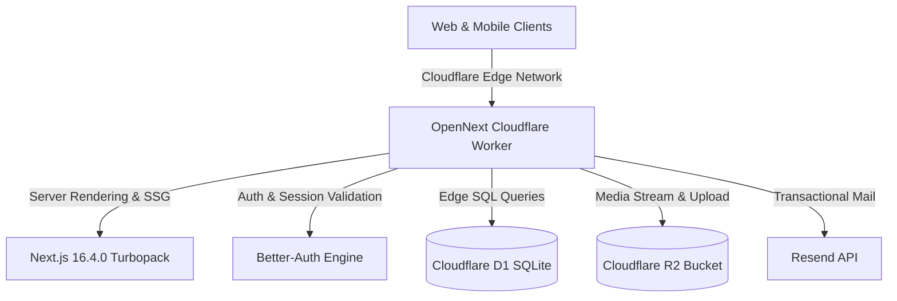

# MLHK Infotech — Digital Ecosystem & Enterprise Edge Platform

[](https://mlhk.in)
[-black?style=flat-square&logo=next.js&logoColor=white)](https://nextjs.org)
[](https://react.dev)
[](https://www.typescriptlang.org)
[](https://tailwindcss.com)
[](https://developers.cloudflare.com)
[](#security--hardening)

> **Innovate. Integrate. Elevate.**  
> Official web platform, content management suite, CRM, and ERP system for **MLHK Infotech**, serving businesses, startups, and institutions across India.

- **Production URL:** [https://mlhk.in](https://mlhk.in)
- **Founder & CEO:** Hariom Vishwkarma
- **Headquarters:** Barnawad, Shajapur, Madhya Pradesh, India
- **Contact:** [admin@mlhk.in](mailto:admin@mlhk.in) | [+91 91651 00124](tel:+919165100124) | [WhatsApp](https://wa.me/919165100124)

---

## 🌟 Overview & Subsidiary Brands

MLHK Infotech architects full-scale digital infrastructure—custom web software, Android apps, SaaS portals, CRM/ERP workflows, and AI automation.

### Venture Portfolio
- **Erotix Green Energy:** Solar infrastructure, rooftop energy, and renewable intelligence.
- **IKSC India:** High-speed e-commerce, consumer retail, and supply chain solutions.
- **Red Xerox Studio:** High-end creative printing, brand identity, and physical packaging.
- **RX Media:** Digital marketing, performance advertising, and creator talent networks.
- **TET News:** Regional and national investigative digital journalism.
- **Hariom Vishwkarma Institute of Technology (HVIT):** Skill development, vocational training, and technical engineering academy.

---

## 🏛️ Platform Architecture & Stack



### Core Technologies
- **Framework:** [Next.js 16.4.0](https://nextjs.org) with Turbopack, App Router, and Server Actions.
- **Runtime:** [OpenNext for Cloudflare](https://opennext.js.org/cloudflare) deployed to **Cloudflare Workers**.
- **Database:** [Cloudflare D1](https://developers.cloudflare.com/d1/) (Serverless distributed SQLite) managed via [Drizzle ORM](https://orm.drizzle.team/).
- **Media & Asset Storage:** [Cloudflare R2](https://developers.cloudflare.com/r2/) object storage (S3-compatible, zero egress costs).
- **Authentication:** [Better-Auth](https://better-auth.com/) with SQLite timestamp adapter and role-based access control (RBAC).
- **Design System:** Obsidian Dark luxury theme (`#050607`, warm amber `#ff9f1c`), Tailwind CSS v4, Base UI, Three.js 3D canvas, and GSAP motion animations.

---

## 📦 System Modules & Capabilities

### 1. Public Platform
- **Landing Experience (`/`):** 3D interactive service cubes (Three.js), GSAP scroll triggers, live database portfolio preview, venture showcase, and verified customer testimonials.
- **Services Directory (`/services`):** Deep-dive technical service pages (*Web Development, Mobile Apps, AI Automation, Cloud Migration, Enterprise ERP*).
- **Portfolio Showcase (`/portfolio`):** Filterable showcase of client products, screenshots, and live project links.
- **Editorial Insights (`/blog`):** Markdown and rich-text editorial publishing engine with search and tag filters.
- **Contact & Inquiries (`/contact`):** Instant lead capture connecting to the central CRM pipeline.

### 2. Admin Suite (`/admin`)
- **Global Search (`⌘K`):** Fast multi-category search across posts, leads, projects, clients, and services.
- **Content & CMS:**
  - **Blog Studio:** Rich text WYSIWYG editor powered by Tiptap (`prose-invert`), slug auto-generation, and draft/published controls.
  - **Media Library:** Drag-and-drop file uploader streaming directly to Cloudflare R2, image preview grid, and instant URL copying.
  - **Navigation Menus:** Visual editor for header, footer, and mobile navigation link trees.
  - **Custom Pages & Site Settings:** Legal documents, brand metadata, and global parameters.
- **CRM & Client Pipeline:**
  - **Inbound Leads:** Real-time pipeline with interactive stage management (*New, Contacted, Proposal, Won, Lost*).
  - **Client Profiles:** Directory of client entities, GSTIN numbers, and contact records.
  - **Follow-up Reminders:** Task tracker with overdue alerts and milestone completion toggles.
- **ERP & Operations:**
  - **Projects & Kanban Board:** 4-column agile board (*To Do, In Progress, Review, Done*) with sprint tasks and budget summaries.
  - **Tax Invoices & Billing:** Itemized invoice generator with automated GST calculation (0% to 28%), line items, and payment status updates.
  - **Expense Ledger:** Track operational costs, licenses, and overheads.
  - **Support Tickets:** SLA-driven client issue tracking and priority badges (*Low, Medium, High, Urgent*).

### 3. Client Portal (`/portal`)
- Authenticated client workspace to view active project deliverables, check invoice payment statuses, and submit support tickets.

---

## 🔒 Security & Hardening

- **Zero Production Vulnerabilities:** Audited with `npm audit --omit=dev` ensuring 0 critical, high, or moderate vulnerabilities.
- **Edge Rate Limiting:** Custom token-bucket rate limiter enforcing client IP limits via Cloudflare headers (`cf-connecting-ip`).
- **Edge Media Streaming (`/api/media/[...key]`):** Validates key formats, blocks path traversal attacks (`..`), sets `X-Content-Type-Options: nosniff`, and leverages long-term browser cache headers.
- **Secure File Ingestion:** Strict 15MB file size boundary, filename sanitization, and MIME-type verification (JPEG, PNG, WebP, SVG, MP4, PDF).
- **Authentication Roles:** Granular RBAC supporting `super_admin`, `admin`, `manager`, `employee`, and `client`.

---

## 🛠️ Local Development Setup

### Prerequisites
- Node.js `>= 20.x`
- npm `>= 10.x`
- Cloudflare Wrangler CLI (`npm i -g wrangler`)

### 1. Clone & Install
```bash
git clone https://github.com/mlhkhariom/mlhk.in.git
cd mlhk.in
npm install
```

### 2. Environment Variables
Create a local `.dev.vars` file for Cloudflare secrets and `.env.local` for local utilities:

```env
# .dev.vars (Used by Cloudflare Workers / Wrangler)
BETTER_AUTH_SECRET="your-32-character-random-secret"
BETTER_AUTH_URL="http://localhost:3000"
RESEND_API_KEY="re_your_resend_api_key"
NEXT_PUBLIC_SITE_URL="http://localhost:3000"
```

### 3. Local Cloudflare D1 Database Setup
Apply the database migrations to local D1 storage:

```bash
# Run local migrations
npx wrangler d1 migrations apply mlhk-in --local

# Or push schema changes
npm run db:generate
```

### 4. Run Development Server
```bash
npm run dev
```
Open [http://localhost:3000](http://localhost:3000) in your browser.

---

## 🚀 Build & Deployment

The repository is configured for automatic continuous deployment to **Cloudflare** on every push to the `main` branch.

### Manual Commands

| Script | Purpose |
| :--- | :--- |
| `npm run dev` | Starts local Next.js development server with Turbopack. |
| `npm run build` | Compiles optimized Next.js production build. |
| `npm run pages:build` | Packages application for Cloudflare Worker runtime via OpenNext. |
| `npm run pages:deploy` | Deploys Worker bundle directly to Cloudflare. |
| `npm run preview` | Runs local OpenNext Cloudflare edge preview simulation. |
| `npm run cf-typegen` | Regenerates Cloudflare D1, R2, and KV TypeScript bindings. |
| `npm run db:generate` | Generates Drizzle SQL migrations from schema. |
| `npm run db:studio` | Launches visual Drizzle database GUI. |

---

## 📄 License & Attribution

Copyright © 2020–2026 **MLHK Infotech**. All rights reserved.  
Unauthorized copying, modification, or distribution of proprietary systems and branding is strictly prohibited.
